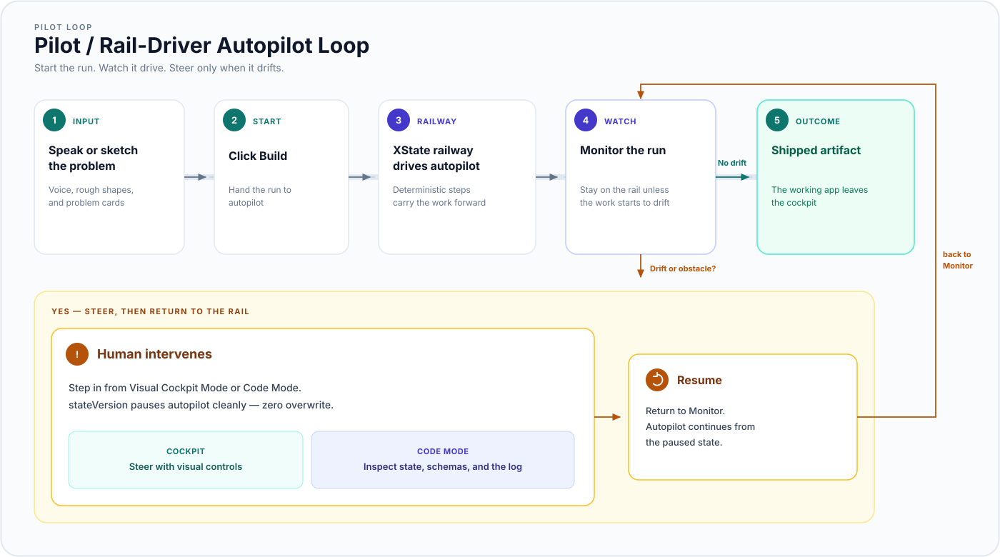
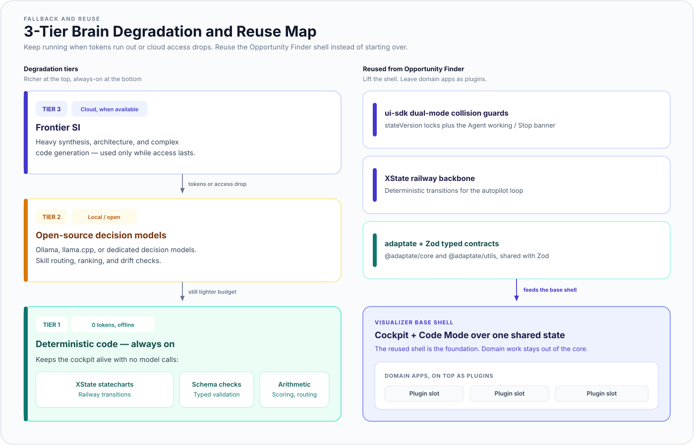

# Visualizer

A visual pilot cockpit for self-hosted SI — speak, sketch, and let the run drive itself.


## Problem

Text-box-only SI workflows force a builder to describe, wait, and re-describe — hiding the plan in a chat log and locking the work to a cloud session. Visualizer turns spoken thinking, rough sketches, and live mockups into a self-hosted cockpit you can start, watch, and steer. When tokens run out or access drops, the same local control graph keeps running on deterministic code and lightweight open-source decision models. SGI stays a horizon; this scaffold is self-hosted SI you can pause.

## Locked Decisions

| Decision | Lock |
| :--- | :--- |
| **Code Mode toggle** | One shared typed state, on a `@ui-sdk/react` one-app, two-modes base. |
| **Reuse, don't rebuild** | Opportunity Finder's dual-mode collision guards (`stateVersion` + Stop banner), XState railway, and `adaptate` + Zod typed contracts. |
| **3-tier fallback** | Deterministic code and lightweight open-source decision models when tokens run out or access is lost. |
| **Local tool handoff** | Coding tasks go to available local CLI and GUI tools (Cursor, Claude Code, and other local harnesses) plus essential MCP connectors. |





## Comparison: Visualizer vs. Chopin and Ecosystem References

| Dimension | Visualizer | [Chopin](https://githubnext.com/projects/chopin/) (GitHub Next) |
| :--- | :--- | :--- |
| **Input** | Voice- and canvas-first | Document- and chat-first (MDX, chat, and comments) |
| **Primary user** | Solo builder, from idea to shipped app | Software teams aligning on a feature before coding |
| **Core primitives** | Problem-statement cards, live mockups, freehand sketches, pluggable design systems, database arrows, Build trigger | Living MDX plan, decision cards, research blocks, side-by-side UI prototypes, jigs |
| **Output** | Direct build trigger from the cockpit | Living, versioned specification, handed to a coding agent via MCP |
| **Collaboration** | Human-in-the-loop solo flow | Real-time multiplayer (teammates + agents) |
| **Anchored to** | Workflow, skills, and local tools | An existing GitHub repository |
| **Maturity** | Early scaffold | Early open-source prototype |
| **Bridge** | Can import or export via MCP later, if desired | Exposes an MCP server |

**Ecosystem references** — useful around the cockpit, not a substitute for it:

- **[Lopsi](https://github.com/frankievalentine/lopsi-bot-eve)** — third-party Apache-2.0 template on [Vercel Eve](https://github.com/vercel/eve). Its folder-per-agent layout is inspiration only; this repo does not fork Lopsi, and the cockpit is not built around Eve.
- **[Vercel Board](https://github.com/vercel/board)** — a hosted experimental message and task board. It is not this cockpit's log and not a visual canvas. The shared log is Ensembly. See [`docs/decisions/001-ensembly-vs-vercel-board-sync.md`](docs/decisions/001-ensembly-vs-vercel-board-sync.md).

## Run

```sh
pnpm install
pnpm dev
pnpm typecheck && pnpm test && pnpm test:critical-flows && pnpm test:mbt && pnpm verify:formal && pnpm build
```

`@visualizer/core` holds the shared workspace, collision guards, XState railway, 3-tier brain, and local tool contracts. `@visualizer/web` is the one app: Visual Cockpit and Code Mode read and write that same state. Button and toggle behavior comes from `@ui-sdk/react`, wrapped in `apps/web/src/ui/controls.tsx`.

Step 1 opens with problem cards for Step 2 of Visualizer itself: freehand canvas sketching, a live WebMCP `document.modelContext` bridge, and a card titled "Ensembly shared log". [`docs/decisions/001-ensembly-vs-vercel-board-sync.md`](docs/decisions/001-ensembly-vs-vercel-board-sync.md) records why that log is Ensembly, not a `@vercel/board` SQLite file. Build runs the Tier 1 railway. Stop pauses it. A verified Step 2 brief then shows in both modes.

The canvas plate takes freehand ink. Each stroke is pinned to the freehand problem card, stored on the shared workspace, and kept in `localStorage` across a reload. Code Mode lists those strokes and can clear them. A stroke during a working phase pauses the run and keeps the ink. The page now registers the WebMCP tools on native `modelContext` or the local bridge. Cross-machine Ensembly sync remains open.

The Memory panel, in both modes, lists Pulse Memory, the Canon 1 `pulse-pack-v1` sparse inject, and workflow lessons. Ensembly is the append-only ledger. A record promotes into Pulse Memory after a confirmed outcome, a user-stated trace, or a tool-verified trace with a matching verify hash. Superseded traces stay out of the active inject. A lesson names a railway phase and a problem card, and recording it does not pause a working phase. Older workspaces that lack those fields still load. Neo4j is an optional projection; the commands and Cypher are in `docs/MEMORY-NEO4J.md`. CI uses the in-memory graph port.

### Local decision model

Tier 2 calls an OpenAI-compatible server. `VISUALIZER_LOCAL_MODEL_URL` defaults to `http://127.0.0.1:11434/v1`. `VISUALIZER_LOCAL_MODEL_NAME` defaults to `decision`. On the machine aliased `laptop-1`, point those variables at the local server and run:

```sh
pnpm test:local-model
```

`VISUALIZER_LOCAL_MODEL_STRICT=1` exits non-zero unless Tier 2 answers. The critical-flow smoke runs the same command and accepts a Tier 1 fallback, so a missing local server does not fail CI. The cockpit Build stays on Tier 1.

Critical flows are listed in `docs/CRITICAL-FLOWS.md`. Test commands are listed in `docs/TEST-SUITE.md`. The target layering (thin native core, `adaptate` acceleration, a thin bridge, and the JS/WebView state layer) is in `docs/ARCHITECTURE-LAYERS.md`, including the [origin and `@ctatedev` fleet comparison](docs/ARCHITECTURE-LAYERS.md#origin-pain-points-and-fleet-topology-comparison-ctatedev-reference). `pnpm test:mbt` regenerates simple paths from the XState 6 railway and checks each step against the workspace and the connector calls. `pnpm verify:formal` checks `stateVersion` and the pilot railway. Why those tools were chosen, and whether the choice was recalled or looked up, is in `docs/TECH-CHOICES.md`. Browser steps for the cockpit live in `.cursor/skills/verify-visualizer/`.

## References

- [`adaptate`](https://github.com/p10ns11y/adaptate) (`@adaptate/core`, `@adaptate/utils`) — typed contracts reused with Zod. The autopilot stream uses `transformSchema`, `makeConditionalSchemaTransformer`, `parse` / `parseStream` from `@adaptate/core/result`, and `fromAsyncIterableSteps` from `@adaptate/core/stream-incremental`. Connector calls use `createStreamValidator`, `isSettled`, and `verifyStream` from `@adaptate/core`, and connector schemas use `zodToOpenAPISchema` from `@adaptate/utils`.
- `@ui-sdk/react` — one-app, two-modes primitives and shared-state interaction
- [XState](https://xstate.js.org) 6 — statecharts and the railway backbone
- [Chopin](https://githubnext.com/projects/chopin/) — GitHub Next's multiplayer MDX planning prototype
- [Lopsi](https://github.com/frankievalentine/lopsi-bot-eve) — folder-per-agent layout inspiration
- [Vercel Board](https://vercel.com/docs/board) — hosted experimental log compared in [`docs/decisions/001-ensembly-vs-vercel-board-sync.md`](docs/decisions/001-ensembly-vs-vercel-board-sync.md). Not the shared store.
- [ensembly](https://github.com/thecuriousts/ensembly) — Canon 1 pulse pack (`pulse-pack-v1`) that feeds the memory graph. Older `ensembly-pulse-pack-v1` packs still import.
- [Neo4j JavaScript driver](https://neo4j.com/docs/javascript-manual/current/) — optional Bolt projection of Pulse Memory and workflow lessons
- [Chris Tate, `@ctatedev`, 27 Nov 2026 fleet diagram](https://x.com/ctatedev/status/2126180726278353288) — independent local/remote fleet sketch compared in `docs/ARCHITECTURE-LAYERS.md`
