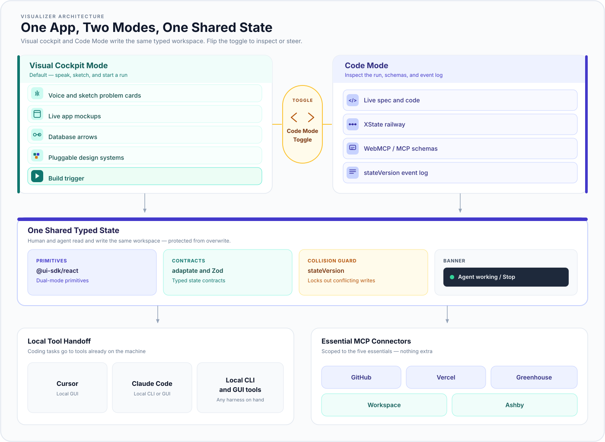

# Visualizer

A visual pilot cockpit for self-hosted SI — speak, sketch, and let the run drive itself.

## Problem

Text-box-only SI workflows force a builder to describe, wait, and re-describe — hiding the plan in a chat log and locking the work to a cloud session. Visualizer turns spoken thinking, rough sketches, and live mockups into a self-hosted cockpit you can start, watch, and steer. When tokens run out or access drops, the same local control graph keeps running on deterministic code and lightweight open-source decision models.

## Locked Decisions

| Decision | Lock |
| :--- | :--- |
| **Code Mode toggle** | One shared typed state, on a `@ui-sdk/react` one-app, two-modes base. |
| **Reuse, don't rebuild** | Opportunity Finder's dual-mode collision guards (`stateVersion` + Stop banner), XState railway, and `adaptate` + Zod typed contracts. |
| **3-tier fallback** | Deterministic code and lightweight open-source decision models when tokens run out or access is lost. |
| **Local tool handoff** | Coding tasks go to available local CLI and GUI tools (Cursor, Claude Code, and other local harnesses) plus essential MCP connectors. |

## Comparison: Visualizer vs. Chopin and Ecosystem References

| Dimension | Visualizer | [Chopin](https://githubnext.com/projects/chopin/) (GitHub Next) |
| :--- | :--- | :--- |
| **Input** | Voice- and canvas-first | Document- and chat-first (MDX, chat, and comments) |
| **Primary user** | Solo builder, from idea to shipped app | Software teams aligning on a feature before coding |
| **Core primitives** | Problem-statement cards, live mockups, freehand sketches, pluggable design systems, database arrows, Build trigger | Living MDX plan, decision cards, research blocks, side-by-side UI prototypes, jigs |
| **Output** | Direct build trigger from the cockpit | Living, versioned specification, handed to a coding agent via MCP |
| **Collaboration** | Human-in-the-loop solo flow | Real-time multiplayer (teammates + agents) |
| **Anchored to** | Workflow, skills, and local tools | An existing GitHub repository |
| **Maturity** | Early scaffold | Early open-source prototype |
| **Bridge** | Can import or export via MCP later, if desired | Exposes an MCP server |

**Ecosystem references** — useful around the cockpit, not a substitute for it:

- **[Lopsi](https://github.com/frankievalentine/lopsi-bot-eve)** — third-party Apache-2.0 template on [Vercel Eve](https://github.com/vercel/eve). Its folder-per-agent layout is inspiration only; this repo does not fork Lopsi, and the cockpit is not built around Eve.
- **[Vercel Board](https://github.com/vercel/board)** — a headless message and task board. Optional later as a local SQLite work log (`npx @vercel/board serve`, including `--tailscale`). It is not a visual canvas.

## References

- [`adaptate`](https://github.com/p10ns11y/adaptate) (`@adaptate/core`, `@adaptate/utils`) — typed contracts reused with Zod
- `@ui-sdk/react` — one-app, two-modes primitives and shared-state interaction
- [XState](https://xstate.js.org) — statecharts and the railway backbone
- [Chopin](https://githubnext.com/projects/chopin/) — GitHub Next's multiplayer MDX planning prototype
- [Lopsi](https://github.com/frankievalentine/lopsi-bot-eve) — folder-per-agent layout inspiration
- [Vercel Board](https://github.com/vercel/board) — optional local task and event log
