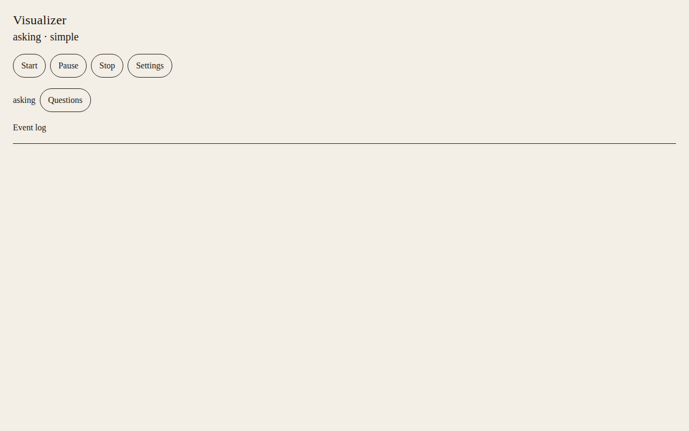

# Visualizer

One screen. It shows the view for the current stage, and the event log.



## Run

```sh
pnpm install
pnpm dev
```

The dev server listens on `127.0.0.1:5173`.

## Docs

- [Architecture layers](docs/ARCHITECTURE-LAYERS.md)
- [Critical flows](docs/CRITICAL-FLOWS.md)
- [Test suite](docs/TEST-SUITE.md)
- [Tech choices](docs/TECH-CHOICES.md)

## References

- [`adaptate`](https://github.com/p10ns11y/adaptate) — `@adaptate/core` and `@adaptate/utils`. Local reading copy: `scripts/fetch-ref.sh adaptate`.
- [UI SDK](https://ui-sdk.dev) — `@ui-sdk/react` and `@ui-sdk/core` `0.1.0-beta.19`, the components on the screen.
- [XState](https://xstate.js.org) 6 (`xstate@6.0.0-beta.5`) — the flow graph. Local reading copy: `scripts/fetch-ref.sh xstate`.
