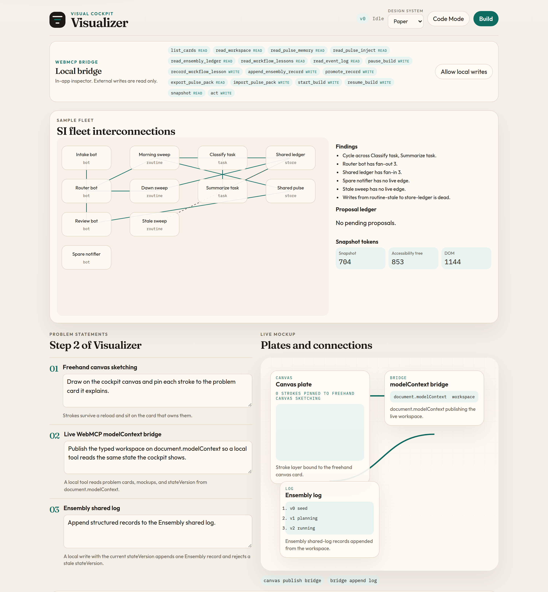
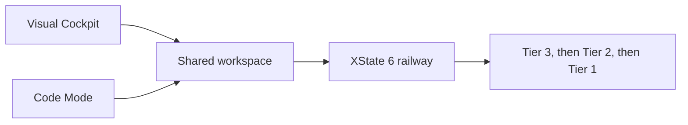

# Visualizer

A visual pilot cockpit for self-hosted SI: speak, sketch, and steer one shared workspace.





Visual Cockpit and Code Mode read and write that workspace. XState 6 owns the railway.

## Run

```sh
pnpm install
pnpm dev
```

The dev server listens on `127.0.0.1:5173`.

## Docs

- [Architecture layers](docs/ARCHITECTURE-LAYERS.md) — locks, layers, and neighbors
- [Critical flows](docs/CRITICAL-FLOWS.md)
- [Test suite](docs/TEST-SUITE.md)
- [Memory graph](docs/MEMORY-NEO4J.md)
- [Tech choices](docs/TECH-CHOICES.md)
- Decisions: [001](docs/decisions/001-ensembly-vs-vercel-board-sync.md), [002](docs/decisions/002-chopin-interop-via-mcp.md), [003](docs/decisions/003-ensembly-pulse-alignment-audit.md), [004](docs/decisions/004-headless-mcp.md), [005](docs/decisions/005-dynamic-ui-catalog.md), [006](docs/decisions/006-vendor-library-source.md)
- Patterns: [XState 6](agent-patterns/xstate-v6.md), [adaptate](agent-patterns/adaptate.md)

## References

- [`adaptate`](https://github.com/p10ns11y/adaptate) — `@adaptate/core` and `@adaptate/utils`. Typed streams, schema checks, and OpenAPI conversion. The reading copy is `repos/adaptate`.
- [XState](https://xstate.js.org) 6 (`xstate@6.0.0-beta.5`) — the railway. The reading copy is `repos/xstate`.
