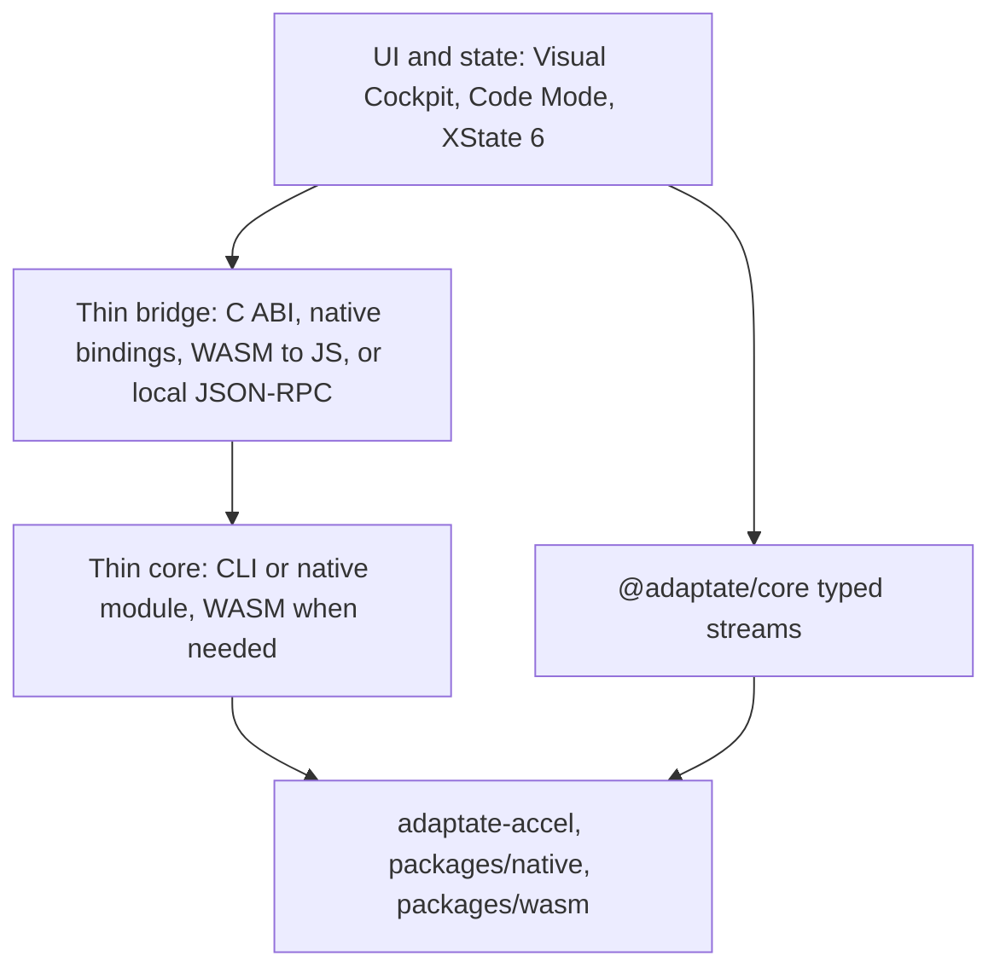

# Architecture layers

Target layering for Visualizer. This foundation step does not add a native crate. Today the shared workspace, the XState 6 railway, and the cockpit live in TypeScript (`@visualizer/core`, `@visualizer/web`). Later steps follow this spec instead of growing a second heavy runtime in JavaScript.

The diagram is the dependency direction: the UI talks to a thin bridge, the bridge talks to a thin core, and heavy payload work stays in [`adaptate`](https://github.com/p10ns11y/adaptate).

## 1. Thin platform-independent core

A small core in a memory-safe low-level language. Rust or Zig is preferred. C or C++ is acceptable when a dependency forces it. The core runs as a CLI or a native module, and it compiles to WASM when a browser or a portable host needs the same behavior.

The core stays thin: process boundaries, version checks, and calls into acceleration. It does not own the cockpit, the railway, or a second copy of stream scanning.

This document does not pick Rust or Zig for that core. `adaptate` acceleration is already Rust, so a later step that creates the core re-checks current tooling and then picks one language. See `docs/TECH-CHOICES.md`.

## 2. adaptate, without a second copy

Heavy data and typed streams use the modules that already exist on `main` of `p10ns11y/adaptate` (read 2026-11-27):

| Piece | Role |
| :--- | :--- |
| `crates/adaptate-accel` | Rust library `adaptate-accel` `0.1.0`. Crate types `rlib` and `cdylib`. In-memory payload checks and streaming UTF-8 JSON. It does not open files. |
| Feature `native` | Node-API addon via `napi`. `@adaptate/native` `3.0.0` loads it. |
| Feature `wasm` | `wasm-bindgen` exports. `@adaptate/wasm` `3.0.0` loads the `wasm32-unknown-unknown` build. |
| `packages/accel` | `@adaptate/accel` `3.0.0` routes to those optional packages and keeps a pure JavaScript scanner when they are absent. |
| `@adaptate/core` | Typed stream and schema tools already used by this repo. |

Visualizer calls those packages. It does not reimplement the scanner, the manifest checks, or a parallel WASM/native addon.

## 3. Thin bridge

Exactly one thin surface exposes the core to JavaScript:

- a C ABI or native binding, or
- a WASM/JS bridge, or
- a local REST or JSON-RPC process on the same machine.

The bridge transports typed calls and results. It does not host UI state, and it does not re-check payloads that `adaptate-accel` already checks.

## 4. JS / WebView UI and state

Visual Cockpit and Code Mode stay a JavaScript WebView. XState 6 owns the pilot railway. `stateVersion`, human pause, and the tool-call contracts stay in that state layer and drive the core through the bridge. A view change still does not pause a run. A human edit during a working phase still does.

## What this step does not do

No Rust or Zig toolchain is added here. No new package depends on `@adaptate/native`, `@adaptate/wasm`, or `@adaptate/accel`. Those integrations are a later step, after review of this foundation.
