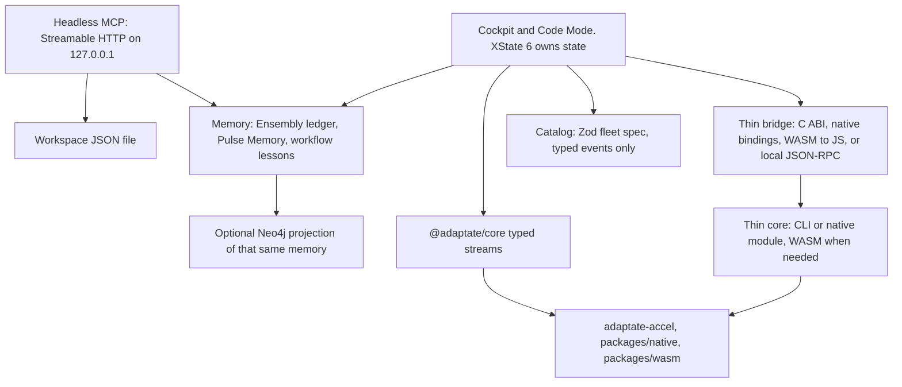
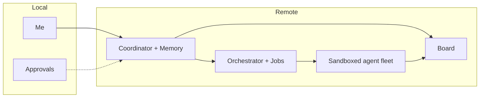
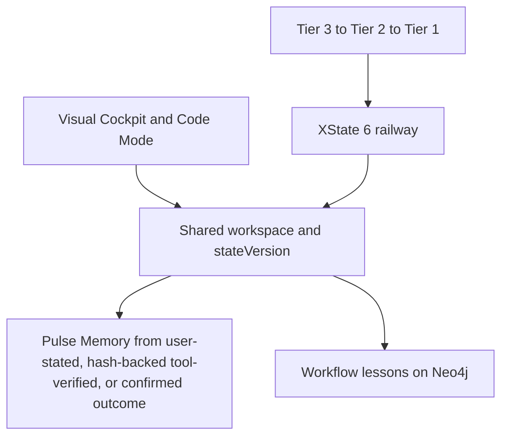

# Architecture layers

Target layering for Visualizer. This foundation step does not add a native crate. Today the shared workspace, the XState 6 railway, and the cockpit live in TypeScript (`@visualizer/core`, `@visualizer/web`). Later steps follow this spec instead of growing a second heavy runtime in JavaScript.

The UI talks to a thin bridge, the bridge talks to a thin core, and heavy payload work stays in [`adaptate`](https://github.com/p10ns11y/adaptate). `repos/xstate` and `repos/adaptate` are read-only library copies, not layers. The cockpit imports `xstate`, `@adaptate/core`, and `@adaptate/utils`.

## Locks

| Decision | Lock |
| :--- | :--- |
| **Code Mode** | One shared typed state. Visual Cockpit and Code Mode are one app. |
| **Reuse** | `stateVersion`, the human pause, the XState railway, and `adaptate` plus Zod contracts. |
| **Three-tier fallback** | Deterministic code, then a lightweight local decision model, when frontier access drops. |
| **Local tool handoff** | Coding work goes to local CLI and GUI tools, plus the MCP connectors this repo already serves. |

## Neighbors

[Chopin](https://githubnext.com/projects/chopin/) plans in multiplayer MDX and stops before execution. This cockpit owns the railway and the shared workspace. The adapter stays a proposal: [`002`](decisions/002-chopin-interop-via-mcp.md).

[Lopsi](https://github.com/frankievalentine/lopsi-bot-eve) is a third-party Apache-2.0 folder-per-agent layout on [Vercel Eve](https://github.com/vercel/eve). It is inspiration only. This repo does not fork it.

[Vercel Board](https://vercel.com/docs/board) is a hosted message and task board. The shared log here is Ensembly. See [`001`](decisions/001-ensembly-vs-vercel-board-sync.md).

## 1. Thin platform-independent core

A small core in a memory-safe low-level language. Rust or Zig is preferred. C or C++ is acceptable when a dependency forces it. The core runs as a CLI or a native module, and it compiles to WASM when a browser or a portable host needs the same behavior.

The core stays thin: process boundaries, version checks, and calls into acceleration. It does not own the cockpit, the railway, or a second copy of stream scanning.

This document does not pick Rust or Zig. `adaptate` acceleration is already Rust, so a later step that creates the core re-checks current tooling and then picks one language. See [`TECH-CHOICES.md`](TECH-CHOICES.md).

## 2. adaptate, without a second copy

Heavy data and typed streams use the modules that already exist on `main` of `p10ns11y/adaptate` (read 2026-11-27):

| Piece | Role |
| :--- | :--- |
| `crates/adaptate-accel` | Rust library `adaptate-accel` `0.1.0`. Crate types `rlib` and `cdylib`. In-memory payload checks and streaming UTF-8 JSON. It does not open files. |
| Feature `native` | Node-API addon via `napi`. `@adaptate/native` `3.0.0` loads it. |
| Feature `wasm` | `wasm-bindgen` exports. `@adaptate/wasm` `3.0.0` loads the `wasm32-unknown-unknown` build. |
| `packages/accel` | `@adaptate/accel` `3.0.0` routes to those optional packages and keeps a pure JavaScript scanner when they are absent. |
| `@adaptate/core` | Typed stream and schema tools already used by this repo. |

Visualizer calls those packages. It does not reimplement the scanner, the manifest checks, or a parallel WASM or native addon.

## 3. Thin bridge

Exactly one thin surface exposes the core to JavaScript:

- a C ABI or native binding, or
- a WASM/JS bridge, or
- a local REST or JSON-RPC process on the same machine.

The bridge transports typed calls and results. It does not host UI state, and it does not re-check payloads that `adaptate-accel` already checks.

## Browser tool surface

Visual Cockpit and Code Mode register the tool list from `packages/core/src/webmcp/`. The page reads `document.modelContext` first, then `navigator.modelContext` when the document getter is missing, then an in-memory bridge (`Local bridge`). Registration uses `registerTool` and an `AbortSignal`. Cleanup aborts that signal and calls `unregisterTool` when the host still exposes it. `provideContext` is not used.

`@visualizer/mcp` serves that same list over Streamable HTTP from `@modelcontextprotocol/server` `2.4.0` and `@modelcontextprotocol/node` `2.1.2`, bound to `127.0.0.1`. The workspace file defaults to `.visualizer/workspace.json` (mode `0600`) inside `VISUALIZER_MCP_STATE_ROOT`. The default port is `8787` (`VISUALIZER_MCP_PORT`). Writes stay off unless `VISUALIZER_MCP_ALLOW_WRITES=1` or the `Authorization` bearer matches `VISUALIZER_MCP_WRITE_TOKEN`. A configured token is required even when the flag is also set. The page stores local approval under `visualizer.webmcp.approval` and removes the key when the toggle is turned off. XState 6 remains the only state owner. The record is [`004`](decisions/004-headless-mcp.md). The flows are CF-08 and CF-09 in [`CRITICAL-FLOWS.md`](CRITICAL-FLOWS.md).

This surface is the page's tool producer. It is not the native core bridge in section 3. Input schemas are Zod objects converted with `zodToOpenAPISchema` from `@adaptate/utils`. `snapshot` is a read. `act` files a pending fleet proposal by action id and does not press cockpit buttons. The catalog is one Zod spec, checked again with `parse` from `@adaptate/core`. An unknown component or a prop the schema does not name is rejected, and the spec is not executed. On the sample fleet the cockpit shows 704 snapshot tokens, 853 for the accessibility listing, and 1144 for the HTML serialization (`ceil(utf-8 bytes / 4)`), rechecked on the running page 2026-11-28. The record is [`005`](decisions/005-dynamic-ui-catalog.md). The flow is CF-10.

Chopin stays outside this core. See [`002`](decisions/002-chopin-interop-via-mcp.md).

## 4. JS / WebView UI and state

Visual Cockpit and Code Mode stay a JavaScript WebView. XState 6 owns the pilot railway. `stateVersion`, human pause, and the tool-call contracts stay in that state layer. A view change does not pause a run. A human edit during a working phase does. The workspace is stored in `localStorage` under `visualizer.workspace`. A payload left under `visualizer.workspace.v1` is read only when the current key is empty.

Freehand strokes, the sample fleet, proposals, the Ensembly ledger, Pulse Memory, and workflow lessons are fields on that same workspace. A lesson, a ledger append, a promotion, and a pulse-pack import do not pause a working phase and do not change `stateVersion`. `canPromote` admits a confirmed outcome, a `user-stated` trace, or a `tool-verified` trace whose verify hash matches the summary. `buildPulseInject` returns at most 8 active traces inside a 120-token budget. The written pack is Canon 1 `pulse-pack-v1`. Setup for the optional Neo4j projection is in [`MEMORY-NEO4J.md`](MEMORY-NEO4J.md). The alignment note is [`003`](decisions/003-ensembly-pulse-alignment-audit.md).

Ensembly is also the shared event and board log. A separate `@vercel/board` SQLite mirror is not that log. Cross-machine sync is the open slice in [`001`](decisions/001-ensembly-vs-vercel-board-sync.md).

## What this step does not do

No Rust or Zig toolchain is added here. No new package depends on `@adaptate/native`, `@adaptate/wasm`, or `@adaptate/accel`. Those integrations are a later step, after review of this foundation.

## Origin, pain points, and fleet comparison

This section records why the cockpit exists, what spoken design settled on 27 Nov 2026, and how that shape sits next to Chris Tate's (`@ctatedev`) fleet diagram from the same day: [How I manage my agent fleet](https://x.com/ctatedev/status/2126180726278353288).

Multi-agent SI work loses the operator. A human edit mid-run can be overwritten with no trace. The live state is a black box. Costly mistakes repeat in the next session. Decisions scatter, with no verified path into memory. A single vendor or a single language then owns the run.

Visualizer's intent is one calm cockpit. Human intent, freehand sketches, the typed workspace, and verified memory stay on one store. The XState 6 railway is the deterministic rule for when a write may land. The locks at the top of this file are that shape. The post went up the same day (27 Nov 2026, 05:06 UTC). It is an independent check, not the source of the cockpit.

Three parts of that diagram are worth taking as drawn.

- **Local versus remote.** `Me` and `Approvals` stay on the local side. An external write is approved there before it runs remotely. The diagram names GitHub, Slack, and Vercel on that list. The same local approval is the rule for any other remote write this cockpit will send, including Greenhouse, Workspace, and Ashby.
- **Coordinator and Orchestrator.** Long-lived intent and memory stay with the Coordinator. Fleet scale and job scheduling stay with the Orchestrator. The two do not share one loop.
- **Radial fleet and a central Board.** Sandboxed workers sit around one Board. In this repo the Board is the Ensembly log, not a `@vercel/board` SQLite file. Claim leases, `agent via human` attribution, scoped sandbox tokens, and a live tail are primitives that sync design may borrow. The fleet is not connected yet. See [`001`](decisions/001-ensembly-vs-vercel-board-sync.md).

The run is a checked statechart, not a chat-only loop. Model-based paths and `pnpm verify:formal` walk the XState 6 machine. Ensembly is the append-only ledger. Pulse Memory and workflow lessons are the two memory layers. Neo4j is the optional projection. The four portable layers above stay local-first. Tier 3 falls through to Tier 2, then to Tier 1. The page publishes the tool list on `document.modelContext` or the local bridge.

The same cockpit can stay local while Approvals remains the local check on every remote write. A remote Orchestrator and a sandboxed fleet can attach later, without moving memory or the railway off the shared store. Cursor, Claude, Grok, and Grok Bot can share that statechart, the Ensembly log, and the Neo4j projection. The sync that carries the log across machines is the open Cloudflare slice in [`001`](decisions/001-ensembly-vs-vercel-board-sync.md). `@vercel/board` stays an optional transport behind a port, not a second store.
