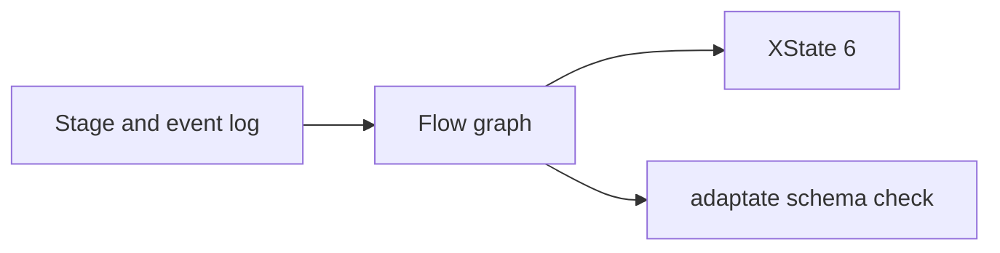
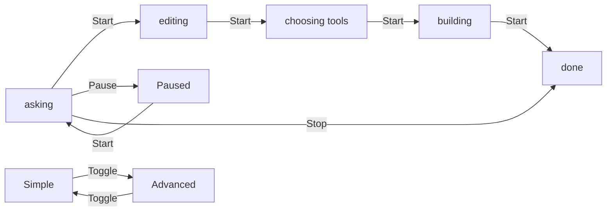

# Architecture layers

The screen shows the current stage and the event log. One machine owns the stage and the mode. Start moves the stage, Pause holds it, and Stop reaches done. The mode toggle does not change the stage. A log line is written only when the machine takes the event.

The pilot railway remains in `@visualizer/core` and is not this screen. [`adaptate`](https://github.com/p10ns11y/adaptate) checks the screen schema. Core keeps importing `xstate`, `@adaptate/core`, and `@adaptate/utils`. `scripts/fetch-ref.sh` still fetches the reading copies.
