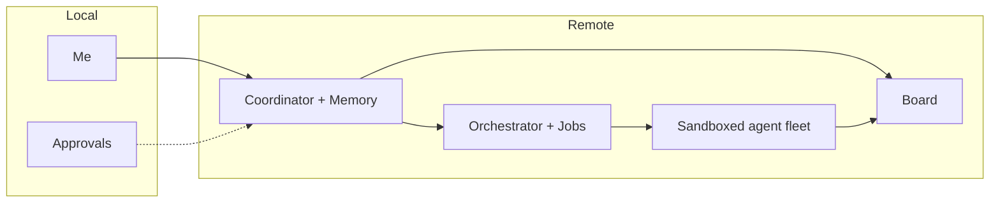
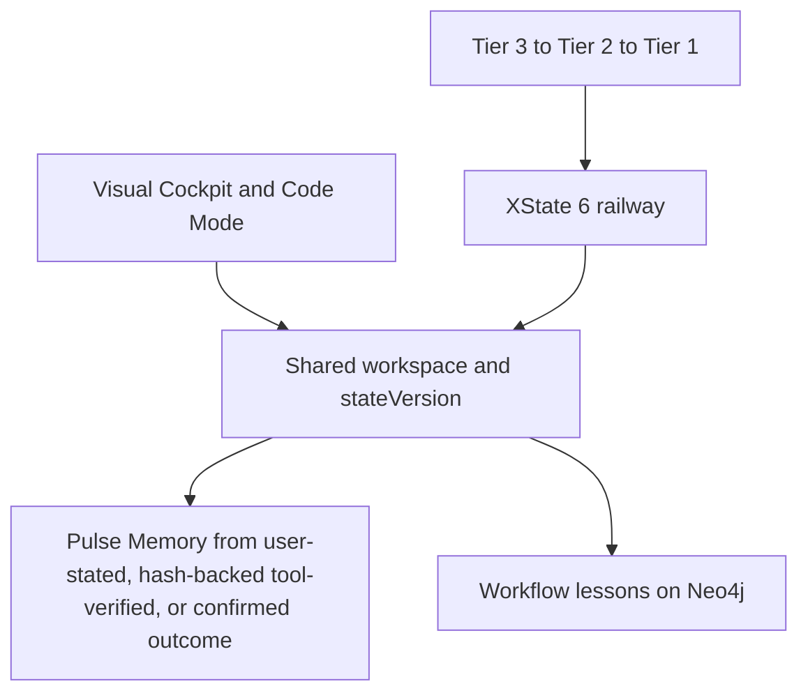

# Architecture layers

Target layering for Visualizer. This foundation step does not add a native crate. Today the shared workspace, the XState 6 railway, and the cockpit live in TypeScript (`@visualizer/core`, `@visualizer/web`). Later steps follow this spec instead of growing a second heavy runtime in JavaScript.

The diagram is the dependency direction: the UI talks to a thin bridge, the bridge talks to a thin core, and heavy payload work stays in [`adaptate`](https://github.com/p10ns11y/adaptate).

```mermaid
flowchart TB
  ui["UI and state: Visual Cockpit, Code Mode, XState 6"]
  mcp["Headless MCP: Streamable HTTP on 127.0.0.1"]
  file["Workspace JSON file"]
  memory["Memory: Ensembly ledger, Pulse Memory, workflow lessons"]
  graph["Optional Neo4j projection of that same memory"]
  bridge["Thin bridge: C ABI, native bindings, WASM to JS, or local JSON-RPC"]
  core["Thin core: CLI or native module, WASM when needed"]
  accel["adaptate-accel, packages/native, packages/wasm"]
  streams["@adaptate/core typed streams"]
  ui --> memory
  mcp --> memory
  mcp --> file
  memory --> graph
  ui --> bridge
  bridge --> core
  core --> accel
  ui --> streams
  streams --> accel
```

## 1. Thin platform-independent core

A small core in a memory-safe low-level language. Rust or Zig is preferred. C or C++ is acceptable when a dependency forces it. The core runs as a CLI or a native module, and it compiles to WASM when a browser or a portable host needs the same behavior.

The core stays thin: process boundaries, version checks, and calls into acceleration. It does not own the cockpit, the railway, or a second copy of stream scanning.

This document does not pick Rust or Zig for that core. `adaptate` acceleration is already Rust, so a later step that creates the core re-checks current tooling and then picks one language. See `docs/TECH-CHOICES.md`.

## 2. adaptate, without a second copy

Heavy data and typed streams use the modules that already exist on `main` of `p10ns11y/adaptate` (read 2026-11-27):

| Piece | Role |
| :--- | :--- |
| `crates/adaptate-accel` | Rust library `adaptate-accel` `0.1.0`. Crate types `rlib` and `cdylib`. In-memory payload checks and streaming UTF-8 JSON. It does not open files. |
| Feature `native` | Node-API addon via `napi`. `@adaptate/native` `3.0.0` loads it. |
| Feature `wasm` | `wasm-bindgen` exports. `@adaptate/wasm` `3.0.0` loads the `wasm32-unknown-unknown` build. |
| `packages/accel` | `@adaptate/accel` `3.0.0` routes to those optional packages and keeps a pure JavaScript scanner when they are absent. |
| `@adaptate/core` | Typed stream and schema tools already used by this repo. |

Visualizer calls those packages. It does not reimplement the scanner, the manifest checks, or a parallel WASM/native addon.

## 3. Thin bridge

Exactly one thin surface exposes the core to JavaScript:

- a C ABI or native binding, or
- a WASM/JS bridge, or
- a local REST or JSON-RPC process on the same machine.

The bridge transports typed calls and results. It does not host UI state, and it does not re-check payloads that `adaptate-accel` already checks.

## Browser tool surface

Visual Cockpit and Code Mode register a WebMCP tool list from `@visualizer/core` (`packages/core/src/webmcp/`). The page reads `document.modelContext` first and `navigator.modelContext` only when the document getter is missing. Registration uses `registerTool` and an `AbortSignal`. Cleanup aborts that signal and, when the host still exposes it, calls `unregisterTool`. `provideContext` is not used.

When neither getter exists, the same calls run on an in-memory bridge and the strip says `Local bridge`. Read tools list cards, the railway phase, Pulse Memory, the sparse pulse inject, the ledger, workflow lessons, and the event log. Ledger, lesson, and event-log reads take `limit` and `cursor`. Write tools pause a build, resume a build, start a build, record a lesson, append or promote an Ensembly record, or import a pulse pack. Those writes check `stateVersion`. A lesson, a ledger append, a promotion, and a pack import do not pause the railway and do not change `stateVersion`. Only an explicit pause does. Writes stay read only until local approval is on. The page stores that choice under `visualizer.webmcp.approval` and removes the key when the toggle is turned off.

`@visualizer/mcp` serves that same tool list over Streamable HTTP from `@modelcontextprotocol/server` `2.4.0` and `@modelcontextprotocol/node` `2.1.2`. The process binds to `127.0.0.1`. The workspace is a JSON file (`VISUALIZER_MCP_STATE`, default `.visualizer/workspace.json`), so a second process sees the same records. Writes stay off unless `VISUALIZER_MCP_ALLOW_WRITES=1` or the `Authorization` bearer matches `VISUALIZER_MCP_WRITE_TOKEN`. A configured token is required even when the flag is also set. XState 6 remains the only state owner. The file is the persisted workspace, not a second machine. The record is [`docs/decisions/004-headless-mcp.md`](decisions/004-headless-mcp.md).

This surface is the page's tool producer. It is not the native core bridge in section 3. Payload checks stay in `adaptate`. Input schemas are Zod objects converted with `zodToOpenAPISchema` from `@adaptate/utils`.

Chopin stays outside this core. A proposed adapter port, not a dependency, is recorded in [`docs/decisions/002-chopin-interop-via-mcp.md`](decisions/002-chopin-interop-via-mcp.md).

## 4. JS / WebView UI and state

Visual Cockpit and Code Mode stay a JavaScript WebView. XState 6 owns the pilot railway. `stateVersion`, human pause, and the tool-call contracts stay in that state layer and drive the core through the bridge. A view change still does not pause a run. A human edit during a working phase still does. The WebMCP strip in both modes shows whether the browser getter was found and which tools are registered. The workspace is stored in `localStorage` under `visualizer.workspace`. A payload left under `visualizer.workspace.v1` is read only when the current key is empty. Missing strokes, ledger, Pulse Memory, and lesson arrays hydrate as empty lists, and a stored card statement is left as written.

Freehand strokes are fields on that same workspace: a `cardId` plus normalized pointer samples. The canvas plate paints them. Code Mode lists and clears them. They are not a bridge payload and not a board log. A stroke during a working phase uses the same human-edit pause as a statement edit.

Pulse Memory and workflow lessons are fields on that same workspace. The Ensembly ledger is the append-only record. A row enters Pulse Memory when `canPromote` admits it: a confirmed outcome, `status: user-stated`, or `status: tool-verified` whose `verifyHash` is `sha256:` plus the SHA-256 of the summary. `supersededBy` keeps that row out of the active pulse. `buildPulseInject` returns at most 8 active traces and stays inside a 120-token budget. The count is `ceil(utf-8 bytes / 4)` of the serialized `{ schema, traces }` payload. The exchange format is Canon 1 `pulse-pack-v1` (`schema` and `format`): integer `coherence_milli`, `traces`, `archive`, `host`, `kind` (`data`, `context`, `fact`, `memory`), `status` (`user-stated`, `tool-verified`, `inferred`, `unknown`), `lock`, `verify_hash`, `prefetch_key`, and optional `superseded_by`. Top-level `ext.content_sha256` and per-trace `ext` may be absent. A missing pack hash is computed. A present pack hash must match. A missing trace `ext` falls back to the envelope fields. Packs labeled `ensembly-pulse-pack-v1` or `peram-pulse-pack-v1` are read only. A payload saved before those fields existed still hydrates. A fractional `coherence_milli` does not.

A workflow lesson points at a railway phase and, when present, a problem card. That write, a ledger append, a promotion, and a pulse-pack import are the SI-maintained aux layer: they stay on `visualizer.workspace` and in the Memory panel, and they do not pause a working phase or change `stateVersion`. `mergeAuxIntoTick` keeps a lesson that landed while a build tick was awaiting. Neo4j is an optional projection of those fields through `MemoryGraphStore`. The cockpit does not require a running database. Setup and the Cypher constraints are in `docs/MEMORY-NEO4J.md`. The projection's promote query and the in-memory port both require a tool-verified row to carry the verify hash of its summary.

Ensembly, adapted for this cockpit, is also the shared event and board log. A separate `@vercel/board` SQLite mirror is not that log. Cross-machine sync is an open design slice (Cloudflare Workers, hooks, and Cloudflare storage such as Durable Objects, D1, or R2). The record is [`docs/decisions/001-ensembly-vs-vercel-board-sync.md`](decisions/001-ensembly-vs-vercel-board-sync.md). How this two-layer memory lines up with Ensembly pulse admissions is recorded in [`docs/decisions/003-ensembly-pulse-alignment-audit.md`](decisions/003-ensembly-pulse-alignment-audit.md). That note marks the three drifts resolved.

## What this step does not do

No Rust or Zig toolchain is added here. No new package depends on `@adaptate/native`, `@adaptate/wasm`, or `@adaptate/accel`. Those integrations are a later step, after review of this foundation.

## Origin, Pain Points, and Fleet Topology Comparison (`@ctatedev` Reference)

This section is about Visualizer only. It records why the cockpit exists, what was already settled in spoken design on 27 Nov 2026, and how that shape sits next to Chris Tate's (`@ctatedev`) fleet diagram from the same day: [How I manage my agent fleet](https://x.com/ctatedev/status/2126180726278353288).

### Original intent and the pain

Multi-agent SI work loses the operator. A human edit mid-run can be overwritten with no trace. The live state is a black box. Costly mistakes repeat in the next session. Decisions scatter, with no verified path into memory. A single vendor or a single language then owns the run.

Visualizer's intent is one calm cockpit. Human intent, freehand sketches, the typed workspace, and verified memory stay on one store. The XState 6 railway is the deterministic rule for when a write may land.

### Independent arrival on 27 Nov 2026

Spoken design on 27 Nov 2026 settled this shape before that post was used as a reference:

- Visual Cockpit and Code Mode share one store.
- `stateVersion` optimistic locking, and the human-pause collision guard.
- An XState 6 railway checked by model-based paths and `pnpm verify:formal`.
- The four-layer portable core, with heavy payload work in [`adaptate`](https://github.com/p10ns11y/adaptate).
- Freehand strokes pinned to a problem card.
- Two-layer memory: an Ensembly ledger into Pulse Memory, plus workflow lessons on the Neo4j projection. That same Ensembly ledger is the shared board log. A separate `@vercel/board` SQLite mirror is not part of this shape. Cross-machine sync is the open slice in [`docs/decisions/001-ensembly-vs-vercel-board-sync.md`](decisions/001-ensembly-vs-vercel-board-sync.md).
- A WebMCP `document.modelContext` bridge.

The post went up the same day (27 Nov 2026, 05:06 UTC) and draws the same split: a person on the local side, a coordinator with memory, an orchestrator that scales work, and a shared board. It is an independent check of that shape, not the source of the cockpit.



### What Visualizer borrows from that topology

Three parts of the diagram are worth taking as drawn.

- **Local versus remote.** `Me` and `Approvals` stay on the local side of the line. An external write is approved there before it runs remotely. The diagram names GitHub, Slack, and Vercel on that list. The same local approval is the rule for any other remote write this cockpit will send, including Greenhouse, Workspace, and Ashby.
- **Coordinator and Orchestrator.** Long-lived intent and memory stay with the Coordinator. Fleet scale and job scheduling stay with the Orchestrator. The two do not share one loop.
- **Radial fleet and a central Board.** Sandboxed workers sit around one Board. Workers and the Coordinator both read that Board. In this repo the Board is the Ensembly log, not a `@vercel/board` SQLite file. Claim leases, `agent via human` attribution, scoped sandbox tokens, and a live tail are primitives that sync design may borrow. The fleet is not connected yet. See [`docs/decisions/001-ensembly-vs-vercel-board-sync.md`](decisions/001-ensembly-vs-vercel-board-sync.md).

### How Visualizer differs



- **Cockpit, Code Mode, and ink, on a checked statechart.** The run is not a chat-only loop. Model-based paths and the formal check walk the XState 6 machine. A human edit during a working phase pauses the build. The statement, the stroke, and `stateVersion` stay. The formal check writes that machine with `machineToJSON`, so the chart is portable machine JSON.
- **Two memory layers, not one flat store.** Ensembly is the append-only ledger. Pulse Memory receives a rule, a costly mistake, or a decision when the row is user-stated, tool-verified with a matching verify hash, or has a confirmed outcome, and `supersededBy` is empty. Agentic workflow memory is the lesson graph: phase, card, friction, rework, and adjustment. Neo4j is the optional projection. CI uses the in-memory port.
- **Four portable layers, local-first or hybrid.** The target is a thin Rust or Zig core, `adaptate` native and WASM acceleration, one thin bridge, and the JS/WebView. This file still does not pick Rust or Zig, and this repo does not add that crate. The post describes a deploymentless fleet on Vercel infrastructure. Visualizer is not tied to that deployment.
- **Tiered brain and WebMCP.** Tier 3 falls through to Tier 2, then to Tier 1 deterministic code. The spoken design publishes the same workspace on `document.modelContext`. The problem card is in the cockpit. The page now publishes the tool list on `document.modelContext` (or the local bridge).

### How this can grow

The same cockpit can stay local while Approvals remains the local check on every remote write. A remote Orchestrator and a sandboxed fleet can attach later, without moving memory or the railway off the shared store.

Cursor, Claude, Grok, and Grok Bot can share that portable statechart, the Ensembly log, and the Neo4j projection. Scheduled reviews of a functional area can then read several repositories from that log and the same confirmed Pulse Memory, instead of opening a fresh session with none of the prior lessons. The sync that carries the log across machines is the open Cloudflare slice in [`docs/decisions/001-ensembly-vs-vercel-board-sync.md`](decisions/001-ensembly-vs-vercel-board-sync.md). `@vercel/board` stays an optional transport behind a port, not a second store.
