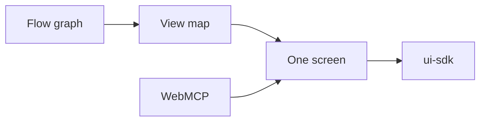
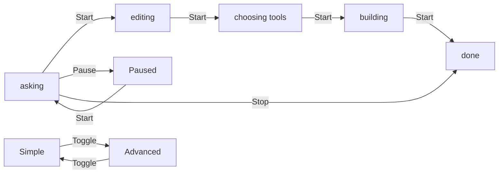

# Architecture layers

The flow graph owns the stage and the mode. The view map picks one spec for that pair. The screen shows that spec, the stage line, and the event log. Advanced mode adds a later panel. A stage mark exposes `stage` to `snapshot`. WebMCP registers `snapshot`, `act`, and `query`. Its allow callback accepts component actions only. Start moves the stage, Pause holds it, and Stop reaches done. The mode toggle does not change the stage. A log line is written only when the machine takes the event.

The pilot railway remains in `@visualizer/core` and is not this screen. [`adaptate`](https://github.com/p10ns11y/adaptate) checks the screen schema. Core keeps importing `xstate`, `@adaptate/core`, and `@adaptate/utils`. `scripts/fetch-ref.sh` still fetches the reading copies.
