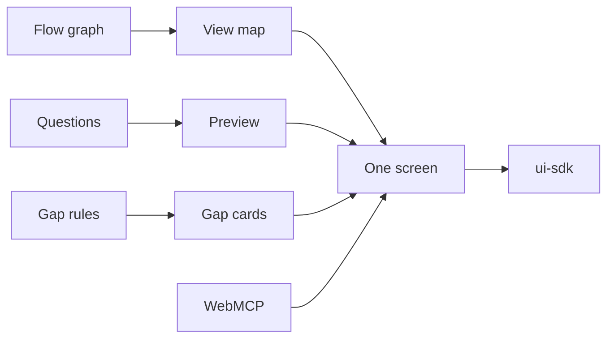
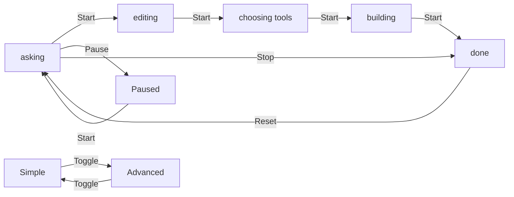

# Architecture layers

The flow graph owns the stage and the mode. The view map picks one spec for that pair. The screen shows that spec, the stage line, and the event log. Asking puts questions beside a preview and fills the height. The log is a short strip. Gap cards are the open decisions for those answers, and an ask mark exposes both to `snapshot`. Advanced mode adds one later panel. A stage mark exposes `stage` to `snapshot`. WebMCP registers `snapshot`, `act`, and `query`. Its allow callback accepts component actions only. Start moves the stage, Pause holds it, and Stop reaches done. Reset after done returns to asking, live, and simple. The mode toggle sits in Settings, off the main screen, along the bottom on a narrow screen, and does not change the stage. Settings loads when it opens. A log line is written only when the machine takes the event. The stored log keeps the latest 200 lines. The next transition reads the stored stage, motion, and mode. The screen shows the latest 20.

[`adaptate`](https://github.com/p10ns11y/adaptate) checks the screen schema. The flow graph is the only state machine. Core keeps importing `xstate`, `@adaptate/core`, and `@adaptate/utils`. `scripts/fetch-ref.sh` still fetches the reading copies.
