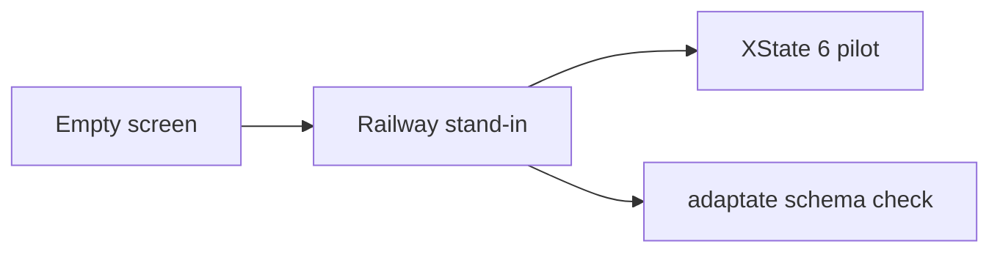

# Architecture layers

The page renders one screen and does not scroll. The pilot railway, `stateVersion`, and human pause stay in `@visualizer/core` so the existing checks still run. A build tick on the stand-in returns the same workspace when the version matches. It does not move the railway.

[`adaptate`](https://github.com/p10ns11y/adaptate) checks the screen schema in `@visualizer/core`. The page renders that one screen. Core keeps importing `xstate`, `@adaptate/core`, and `@adaptate/utils`. `scripts/fetch-ref.sh` still fetches the reading copies. Those copies are not layers and are not stored in git.
