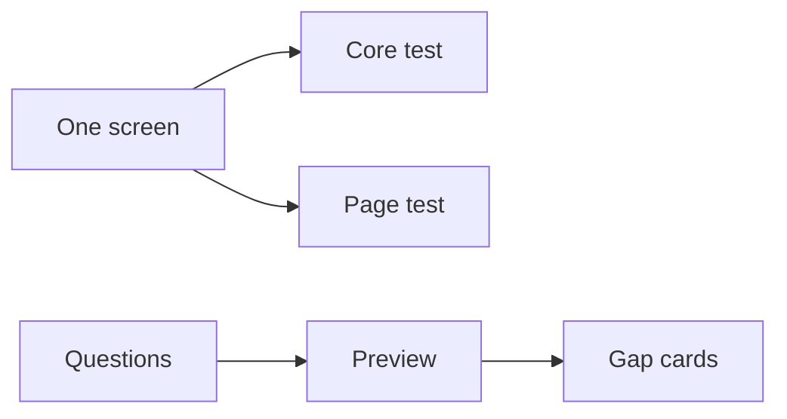

# Critical flows

## CF-01 Stage view and event log

The page shows one screen. The view map supplies the current stage. Advanced mode adds one later panel. The mode toggle sits in Settings, along the bottom on a narrow screen. The log starts empty, the stored log keeps the latest 200 lines, and the screen shows the latest 20, so a new line stays in view. Start, Pause, Stop, Reset, and the mode toggle append a line only when the machine takes the event. Reset after done returns to the start. The page does not scroll.

Test: `CF-01` in `packages/core/src/critical-flows.test.ts`, and the render in `apps/web/src/critical-flow.dom.test.tsx`. The map and the WebMCP wiring are in `packages/core/src/view/map.test.ts` and `apps/web/src/agent.dom.test.tsx`.

## CF-02 Questions, preview, and gap cards

The asking view fills the height. Questions sit on the left and the preview on the right, and the preview grows. The event log is a short strip. Each what answer has one wireframe. Gap cards are the decisions still open, and they change when an answer changes. An answer does not add a log line. The stage line is the one place the stage is written.

Test: `CF-02` in `packages/core/src/critical-flows.test.ts` and `apps/web/src/critical-flow.dom.test.tsx`. Templates and rules are `packages/core/src/ask/templates.test.ts` and `packages/core/src/ask/gaps.test.ts`.

`pnpm verify:formal` checks that every flow state is reachable and that no non-final state is a deadlock. `pnpm test:mbt` walks `getSimplePaths` and covers every transition. Commands are in [`TEST-SUITE.md`](TEST-SUITE.md).
