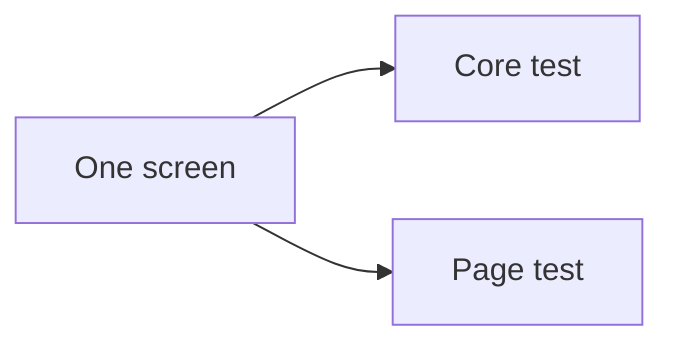

# Critical flows

## CF-01 Stage view and event log

The page shows one screen. The view map supplies the current stage. Advanced mode adds a later panel. The log starts empty. Start, Pause, Stop, and the mode toggle append a line only when the machine takes the event. The page does not scroll.

Test: `CF-01` in `packages/core/src/critical-flows.test.ts`, and the render in `apps/web/src/critical-flow.dom.test.tsx`. The map and the WebMCP wiring are in `packages/core/src/view/map.test.ts` and `apps/web/src/agent.dom.test.tsx`.

`pnpm verify:formal` checks that every flow state is reachable and that no non-final state is a deadlock. `pnpm test:mbt` walks `getSimplePaths` and covers every transition. Commands are in [`TEST-SUITE.md`](TEST-SUITE.md).
