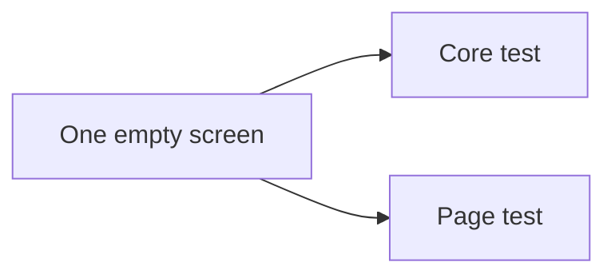

# Critical flows

## CF-01 One empty screen

The page shows one screen. It does not stack a column, and it does not scroll. `bareShell.screens` is `["empty"]` and `bareShell.scroll` is false.

Test: `CF-01` in `packages/core/src/critical-flows.test.ts`, and the render in `apps/web/src/critical-flow.dom.test.tsx`.

`pnpm verify:formal` still checks `stateVersion`, a stale write, and human pause on the pilot railway. `pnpm test:mbt` walks `getSimplePaths` on that railway. Commands are in [`TEST-SUITE.md`](TEST-SUITE.md).
