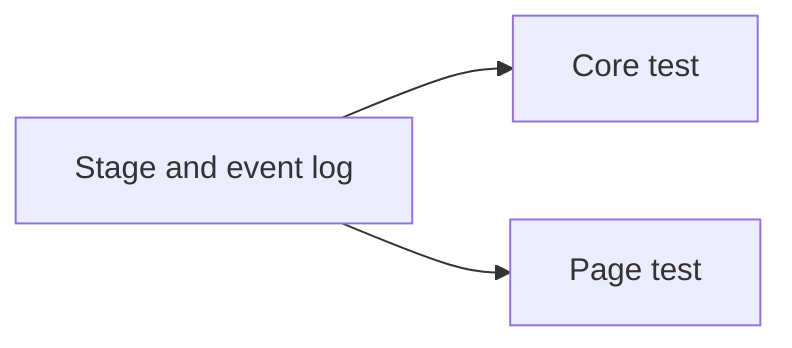

# Critical flows

## CF-01 Stage and event log

The page shows one screen. It shows the stage and the event log, and it does not scroll. The log starts empty. Start, Pause, Stop, and the mode toggle append a line only when the machine takes the event.

Test: `CF-01` in `packages/core/src/critical-flows.test.ts`, and the render in `apps/web/src/critical-flow.dom.test.tsx`.

`pnpm verify:formal` checks that every flow state is reachable and that no non-final state is a deadlock. `pnpm test:mbt` walks `getSimplePaths` and covers every transition. Commands are in [`TEST-SUITE.md`](TEST-SUITE.md).
