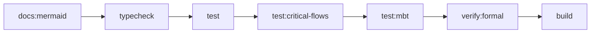

# Test suite

| Command | What it runs |
| :--- | :--- |
| `pnpm test` | `@visualizer/core` Vitest files under `packages/core/src/**/*.test.ts` except `critical-flows.test.ts`. |
| `pnpm test:critical-flows` | `packages/core/src/critical-flows.test.ts` and `apps/web/src/critical-flow.dom.test.tsx`. Names are in [`CRITICAL-FLOWS.md`](CRITICAL-FLOWS.md). |
| `pnpm test:mbt` | `scripts/test-mbt.ts`. Regenerates simple paths with `getSimplePaths` from `xstate/graph`. |
| `pnpm verify:formal` | XState CLI checks plus `checkLockstep`. Bounds are in [formal-verify-visualizer](../.cursor/skills/formal-verify-visualizer/SKILL.md). |
| `pnpm docs:mermaid` | `scripts/verify-mermaid.ts`. Parses every Mermaid fence in `README.md` and `docs/**`. |

`pnpm typecheck` and `pnpm build` bookend those commands. CI does not run `scripts/fetch-ref.sh`. Provenance is in [TECH-CHOICES.md](TECH-CHOICES.md).
